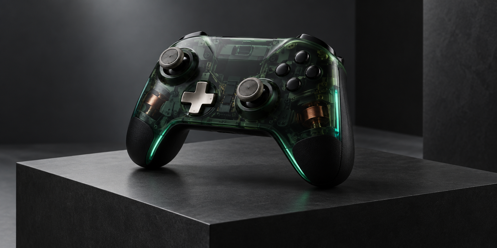

<div align="center">
  
</div>

# Prototype 69 Xbox

<p align="center">
  <a href="https://diufoundry.online"></a>&nbsp;
  &nbsp;
  &nbsp;
  
</p>

<p align="center">
  <b>Spatial interaction, browser gamepad input, and a tactile 3D hardware-inspired workbench.</b><br/>
  <em>An experimental 3D spatial testbed for gamepad telemetry, security attack simulation, and tactile input mapping.</em>
</p>

---

## ✦ System Overview

**Prototype 69 Xbox** combines an interactive 3D visualisation with browser-accessible gamepad input and scripted security scenarios. It is an exploratory interface prototype: the visual panels demonstrate concepts and do not represent verified physical measurements, hardware tamper sensors, or a production security system.

```text
 ┌─────────────────────────────────────────────────────────────────────────────┐
 │                         SPATIAL INPUT / SCRIPTED INTERACTION                       │
 ├─────────────────────┬───────────────────────────────┬───────────────────────┤
 │ INPUT SOURCE: BROWSER GAMEPAD API │ VISUALIZATION: INTERACTIVE │
 │ SECURITY FLOW: SCRIPTED DEMONSTRATION │ HARDWARE VALIDATION: NOT CLAIMED │
 └─────────────────────┴───────────────────────────────┴───────────────────────┘
```

---

## 🕹️ Spatial Architecture & Telemetry Pipeline

```text
[ CONNECTED GAMEPAD ] ── (Browser Gamepad API · browser-reported input)
        │
        ▼
[ INPUT STATE / UI MAPPING ]
        │
        ├─► [ THREE.JS 3D VIEWPORT ] ──► (Interactive Orbit Controls & Wireframe Mesh)
        ├─► [ ANALOG AXIS METER ]   ──► (Axis-state visualisation)
        ├─► [ ATTACK SIMULATION ]   ──► (Scripted visual state sequence)
        └─► [ TAMPER-CONCEPT UI ]  ──► (Illustrative interface state)
```

---

## ✦ Core Capabilities

- **3D Hardware-Inspired Model** (`src/components/GlobeBackground.tsx` & Three.js canvas) — Real-time 3D coordinate gimbal, procedural mesh lighting, and interactive rotation.
- **Gamepad Input Visualisation** — Displays browser-reported axis/button state where a compatible controller and browser expose the Gamepad API; measurements are not laboratory latency or microsecond diagnostics.
- **Cyber Attack & Security Simulation** (`src/components/SecuritySimulation.tsx`, `AttackSimulation.tsx`) — Shows scripted attack/detection/blocked phases as an interface demonstration; it does not perform real packet flooding, signal jamming, or hardware-bus testing.
- **Tamper-Concept UI** (`src/components/TamperDetection.tsx`) — An interface concept for presenting a tamper state; it is not connected to a physical enclosure sensor unless separately implemented.

---

## 🛠️ Project Structure

```text
Prototype69xbox/
├── public/                 # 3D textures, models, and audio sound effects
├── src/
│   ├── components/         # Telemetry panels & Three.js canvas wrappers
│   │   ├── GlobeBackground.tsx      # 3D spatial environment canvas
│   │   ├── SecuritySimulation.tsx   # Security defense testing harness
│   │   ├── AttackSimulation.tsx     # Scripted attack-state UI sequence
│   │   ├── TamperDetection.tsx      # Tamper-state demonstration UI
│   │   └── NetworkVisualization.tsx # Fleet device telemetry mesh
│   ├── App.tsx             # Primary control console & simulation state
│   ├── main.tsx            # React root mount
│   └── index.css           # Matte carbon styling & emerald glow variables
└── package.json            # Three.js, Lucide, React 18, Supabase dependencies
```

---

## Prototype boundary

Security and attack screens are scripted visual scenarios for demonstration. They do not validate secure boot, authenticate a physical device, block real attacks, or certify hardware safety. Do not use the displayed demonstration state as a security assessment.

## ⚡ Quickstart

```bash
# Clone repository
git clone https://github.com/Kishordiu/Prototype69xbox.git
cd Prototype69xbox

# Install dependencies
npm install  # or bun install

# Launch 3D spatial workbench
npm run dev
```

Connect an Xbox or HID controller via USB/Bluetooth and navigate to [http://localhost:5173](http://localhost:5173).

---

<p align="center">
  <b>RESEARCH → BUILD → TEST → SHIP</b><br/>
  <sub>A digital hardware project by <a href="https://diufoundry.online">DIU Foundry</a> · Engineered by K. Kishor Kumar</sub>
</p>
