<div align="center">
  
</div>

<p align="center">
  <a href="https://diufoundry.online"></a>&nbsp;
  &nbsp;
  &nbsp;
  
</p>

<p align="center">
  <b>Sub-millisecond input precision, mechanical wireframe physics, and spatial cyber telemetry.</b><br/>
  <em>An experimental 3D spatial testbed for gamepad telemetry, security attack simulation, and tactile input mapping.</em>
</p>

---

## ✦ System Overview

**Prototype 69 Xbox** merges physical hardware diagnostics with interactive 3D graphics. Built by DIU Foundry, this workbench renders an exploded 3D spatial model alongside live Gamepad API polling, measuring microsecond-level axis jitter, analog trigger travel curves, and tamper-resistance telemetry.

```text
 ┌─────────────────────────────────────────────────────────────────────────────┐
 │                         HARDWARE DIAGNOSTIC TELEMETRY                       │
 ├─────────────────────┬───────────────────────────────┬───────────────────────┤
 │ POLLING RATE: 1000Hz│ ANALOG TRIGGER TRAVEL: RT 92% │ ATTACK SIMULATION: OK │
 │ LATENCY: 0.4ms Jitter│ THUMBSTICK GYRO: ±0.02° Drift │ TAMPER MITIGATION: ON │
 └─────────────────────┴───────────────────────────────┴───────────────────────┘
```

---

## 🕹️ Spatial Architecture & Telemetry Pipeline

```text
[ HARDWARE GAMEPAD ] ── (W3C Gamepad API · 1000 Hz)
        │
        ▼
[ LOW-LATENCY INPUT BUFFER ]
        │
        ├─► [ THREE.JS 3D VIEWPORT ] ──► (Interactive Orbit Controls & Wireframe Mesh)
        ├─► [ ANALOG AXIS METER ]   ──► (Deadzone Calibration & Jitter Elimination)
        ├─► [ ATTACK SIMULATION ]   ──► (Packet Flood & State Integrity Testing)
        └─► [ TAMPER DETECTION ]    ──► (Physical Enclosure Telemetry Log)
```

---

## ✦ Core Capabilities

- **3D Spatial Hardware Model** (`src/components/GlobeBackground.tsx` & Three.js canvas) — Real-time 3D coordinate gimbal, procedural mesh lighting, and interactive rotation.
- **Microsecond Input Diagnostics** — High-precision thumbstick telemetry tracking $(X, Y)$ vector displacement and trigger tension percentages.
- **Cyber Attack & Security Simulation** (`src/components/SecuritySimulation.tsx`, `AttackSimulation.tsx`) — Simulates hardware denial-of-service, signal jamming, and physical bus tampering.
- **Enclosure Tamper Mitigation** (`src/components/TamperDetection.tsx`) — Monitors device enclosure state and flags unauthorized physical disassembly.

---

## 🛠️ Project Structure

```text
Prototype69xbox/
├── public/                 # 3D textures, models, and audio sound effects
├── src/
│   ├── components/         # Telemetry panels & Three.js canvas wrappers
│   │   ├── GlobeBackground.tsx      # 3D spatial environment canvas
│   │   ├── SecuritySimulation.tsx   # Security defense testing harness
│   │   ├── AttackSimulation.tsx     # Packet injection stress tests
│   │   ├── TamperDetection.tsx      # Hardware chassis integrity logs
│   │   └── NetworkVisualization.tsx # Fleet device telemetry mesh
│   ├── App.tsx             # Primary control console & simulation state
│   ├── main.tsx            # React root mount
│   └── index.css           # Matte carbon styling & emerald glow variables
└── package.json            # Three.js, Lucide, React 18, Supabase dependencies
```

---

## ⚡ Quickstart

```bash
# Clone repository
git clone https://github.com/Kishordiu/Prototype69xbox.git
cd Prototype69xbox

# Install dependencies
npm install  # or bun install

# Launch 3D spatial workbench
npm run dev
```

Connect an Xbox or HID controller via USB/Bluetooth and navigate to [http://localhost:5173](http://localhost:5173).

---

<p align="center">
  <b>RESEARCH → BUILD → TEST → SHIP</b><br/>
  <sub>A digital hardware project by <a href="https://diufoundry.online">DIU Foundry</a> · Engineered by K. Kishor Kumar</sub>
</p>
